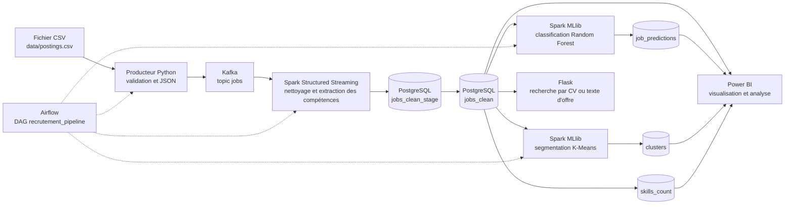

# Job Recommendation Big Data

> **Des offres IT mieux organisées, des compétences plus visibles, des recommandations plus pertinentes.**


**Job Recommendation Big Data** est un projet de traitement et d’analyse d’offres d’emploi IT. Il met en œuvre un pipeline de bout en bout : ingestion avec Kafka, préparation distribuée avec Spark, orchestration avec Airflow, stockage dans PostgreSQL et exploration via une application Flask ou Power BI.

Le projet transforme les annonces en informations exploitables : compétences recherchées, familles de métiers, groupes d’offres et recommandations textuelles à partir d’un CV ou d’une annonce.

## Architecture et flux de données



Les flèches pleines représentent les données. Les flèches en pointillés représentent l’orchestration par Airflow.

### Étapes du pipeline

1. **Ingestion** — le producteur valide les colonnes du CSV et publie chaque annonce dans Kafka avec `job_id` comme clé.
2. **Préparation** — Spark lit le topic, écarte les lignes incomplètes, détecte les compétences et prépare les enregistrements.
3. **Persistance** — chaque lot passe par une table de staging, puis est fusionné dans PostgreSQL avec une mise à jour par `job_id`.
4. **Analyse** — deux traitements Spark MLlib calculent les catégories de métiers et les segments d’offres.
5. **Exploration** — Flask classe les offres proches du contenu d’un CV ou d’une annonce ; Power BI peut interroger les tables PostgreSQL.

## Ce que le projet met en valeur

- Une architecture de données qui relie ingestion, traitement distribué, stockage et exploitation.
- Kafka comme bus de messages et Spark Structured Streaming pour traiter les messages disponibles.
- Des reprises plus sûres grâce aux checkpoints Spark, à la déduplication et aux upserts PostgreSQL.
- Une orchestration lisible dans Airflow, avec les traitements d’analyse exécutés après l’ingestion.
- Des cas d’usage ML concrets : classification de métiers, segmentation d’offres et similarité textuelle.
- Une interface de démonstration pour rechercher des offres pertinentes à partir d’un CV ou d’un texte d’annonce.
- Un environnement local reproductible avec Docker Compose.

## Technologies

| Composant | Rôle |
|---|---|
| Python | Producteur Kafka, application Flask et logique de préparation |
| Apache Kafka | Transport des annonces dans le topic `jobs` |
| Apache Spark 3.5.1 | Traitement des lots et modèles MLlib |
| Apache Airflow 2.9.3 | Orchestration du DAG `recrutement_pipeline` |
| PostgreSQL 15 | Stockage des annonces préparées et des résultats analytiques |
| Flask | Recherche d’offres similaires à partir d’un CV ou d’un texte |
| Power BI | Connexion aux tables pour créer des tableaux de bord |
| Docker Compose | Démarrage des services sur un environnement local |

## Résultats produits

| Table PostgreSQL | Contenu |
|---|---|
| `jobs_clean` | Annonces nettoyées, compétences détectées et données normalisées |
| `skills_count` | Fréquence des compétences dans les offres traitées |
| `job_predictions` | Famille de métier prédite pour les annonces reconnues |
| `clusters` | Groupe attribué à chaque annonce et caractéristiques du groupe |

## Démarrer le projet

### Prérequis

- Docker Desktop avec Docker Compose
- Un fichier d’offres au format CSV
- PowerShell sous Windows, ou un terminal compatible avec Docker Compose

Le fichier CSV doit contenir les colonnes `job_id`, `title` et `description`. Les colonnes `company_name`, `location`, `med_salary`, `formatted_work_type` et `formatted_experience_level` sont facultatives.

### Lancement

1. Crée le fichier de configuration local à partir du modèle :

   ```powershell
   Copy-Item .env.example .env
   ```

   Remplace les mots de passe d’exemple dans `.env` par des valeurs locales privées.

2. Place le CSV dans `data/postings.csv`.

3. Construis et démarre les services :

   ```powershell
   docker compose up --build -d
   docker compose ps
   ```

4. Ouvre Airflow, connecte-toi avec les identifiants générés au premier démarrage, puis déclenche le DAG `recrutement_pipeline` :

   - Airflow : <http://localhost:8085>
   - Application Flask : <http://localhost:5000>
   - Interface Spark : <http://localhost:8086>
   - pgAdmin : <http://localhost:5050>

   Les journaux Airflow permettent de retrouver les informations du premier démarrage :

   ```powershell
   docker compose logs airflow
   ```

La variable `MAX_MESSAGES` dans `.env` limite le nombre d’offres envoyées à Kafka. Sa valeur par défaut est `5000`. La valeur `0` désactive cette limite.

### Base PostgreSQL d’une ancienne installation

Les scripts de `sql/` s’exécutent automatiquement lorsqu’un volume PostgreSQL neuf est initialisé. Sur un volume créé avec une ancienne version du projet, applique une seule fois la migration avant de lancer le DAG :

```powershell
docker compose exec -T postgres sh -lc 'psql -U admin -d "$POSTGRES_DB" -v app_user="$APP_DB_USER" -v app_password="$APP_DB_PASSWORD" -v app_db="$POSTGRES_DB" -v pg_admin=admin -f /docker-entrypoint-initdb.d/migrate.sql'
```

La commande suppose que l’ancien rôle administrateur s’appelle `admin`. Remplace ce nom si ton volume existant utilise un autre rôle. La migration conserve les données existantes et ajoute les contraintes nécessaires aux upserts.

## Connexion Power BI

Pour connecter Power BI à la base locale, utilise l’hôte `localhost`, le port `5432`, la base `recruitment` (ou la valeur `POSTGRES_DB` de `.env`) et le compte applicatif `APP_DB_USER` / `APP_DB_PASSWORD`. Les tables à importer sont `jobs_clean`, `skills_count`, `job_predictions` et `clusters`.

## Vérifier les tests

Avec les dépendances du projet installées dans l’environnement Python :

```powershell
python -m unittest discover -s tests -v
```

Les tests couvrent le classement des offres similaires et les contrôles de téléversement PDF. Ils n’exigent pas de connexion à PostgreSQL.

## Structure du dépôt

```text
airflow/dags/       DAG d'orchestration
producers/          Producteur CSV vers Kafka
spark/              Traitement streaming, modèles ML et recommandation
flask_app/          Interface web et gestion sécurisée des PDF
sql/                Schéma PostgreSQL et script de migration
tests/              Tests unitaires
data/               Emplacement local du CSV (non versionné)
```

## Périmètre actuel

- La source configurée est un fichier CSV local ; aucune connexion directe à LinkedIn n’est incluse.
- Le DAG est déclenché manuellement. Spark traite les messages Kafka disponibles à ce moment-là, puis termine : le pipeline actuel est **orienté lots**, pas un flux continu à faible latence.
- Les étiquettes de classification sont déduites de règles sur les titres. Les métriques calculées ne remplacent pas une évaluation sur des catégories annotées par des personnes.
- La recommandation compare les termes du texte fourni aux annonces ; le score est une similarité textuelle, pas une probabilité d’embauche.
- Docker Compose fournit un environnement de démonstration local, sans configuration haute disponibilité.
- Les PDF scannés comme images nécessitent une étape OCR, qui n’est pas incluse.

## Données et confidentialité

> Le dataset, les CV téléversés, les modèles générés et les secrets locaux sont exclus de Git et du contexte de construction Docker. Ne publie pas de données personnelles ni de fichier `.env` dans le dépôt.

L’application limite la taille des PDF, vérifie leur signature et supprime le fichier temporaire après son traitement. Les modèles Spark sont sauvegardés dans un volume Docker local.

## Arrêter les services

```powershell
docker compose down
```

Cette commande conserve les volumes PostgreSQL, checkpoints et modèles. `docker compose down -v` supprime également ces volumes.
